# Lab 3: Structural Architectural Patterns

**Author:** Cristian Steven Motta Ojeda

**Date:** November 9, 2026

A distributed system based on the **Broker** architectural pattern. A RabbitMQ broker acts as the central connector between a producer (HTTP API) and a consumer (worker), which stores the received messages in MongoDB.

## View

## Description

### Components

| Name | Description |
|------|-------------|
| Component 1 | RabbitMQ broker. Receives messages from producers and forwards them to consumers through the durable `items_queue`. |
| Component 2 | FastAPI producer. Exposes `POST /items` and publishes each item to the broker as a persistent message. |
| Component 3 | Python worker (consumer). Subscribes to `items_queue`, processes each message and stores it in MongoDB. |
| Component 4 | MongoDB database where the consumer stores the processed items. |

### Connectors

| Name | Description |
|------|-------------|
| HTTP - REST connector | Used by clients to send items to the producer (`POST /items`). |
| AMQP connector (publish) | Used by the producer to publish messages to the broker queue. |
| AMQP connector (subscribe) | Used by the consumer to receive messages from the broker queue. |
| Database connector | Connects the consumer to MongoDB. |

## Asynchronous communication

The communication between the producer (C2) and the consumer (C3) is **asynchronous** and goes through the broker (C1). They never communicate directly:

0. When it starts, the consumer declares the durable `items_queue` and subscribes to it.
1. A client sends `POST /items` to the producer.
2. The producer publishes the item as a persistent JSON message to `items_queue`.
3. The producer answers `{"status": "published"}` right away. It does not wait for the item to be processed or stored.
4. Later, the broker delivers the message to the consumer.
5. The consumer stores the item in MongoDB.
6. MongoDB confirms the insertion.
7. The consumer acknowledges the message and the broker removes it from the queue.

Steps 1 to 3 are synchronous for the client, and steps 4 to 7 happen independently of them. This decouples the components:

- **In space:** the producer only knows the broker address and the queue name, not the consumer or the database.
- **In time:** if the consumer is down, the producer can still publish. The broker keeps the message in the queue until the consumer comes back and processes it. I checked this by stopping `component-3`, sending an item, and starting it again. The item was stored once the consumer restarted.
